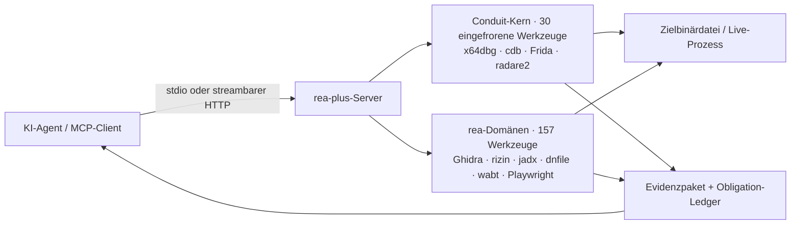

<div align="center">


# Reverse Engine Anything Plus

**Ein MCP-Server für Reverse Engineering — Live-Windows-Debugging plus eine statische Analysesuite mit 157 Werkzeugen für PE/ELF, Mach-O, .NET, APK, IL2CPP, WASM/EVM, Firmware und das Web.**

Ihr Agent stellt Fragen; rea-plus untersucht die Binärdatei und antwortet mit Belegen, nicht mit Vermutungen.

[](https://github.com/Alyhnte/ReaPlus/actions/workflows/ci.yml)
[](https://github.com/Alyhnte/ReaPlus/releases)
[](#-funktionen)
[](#-tests)
[](https://nodejs.org)
[](LICENSE)

[Installation](#-installation) · [Clients](#-client-einrichtung) · [Docker](#-docker) · [Funktionen](#-funktionen) · [Werkzeuge](docs/TOOLS.md) · [Funktionsweise](#-funktionsweise) · [Sicherheit](#-sicherheitsmodell) · [Roadmap](docs/ROADMAP.md) · [FAQ](#-faq)

</div>

---

## ✨ Warum rea-plus?

- 🐞 **Echtes Debugging statt Screenshots** — x64dbg-, cdb- (WinDbg-) und Frida-Engines hinter einem eingefrorenen 30-Werkzeug-Kern: Breakpoints, Stepping, Register, Speicher, Callstacks, Time-Travel-Checkpoints.
- 🧰 **157 statische Werkzeuge** — Ghidra headless, rizin/radare2, .NET-CIL (dnfile) und ILSpy, jadx/apktool/adb, WASM + EVM, Firmware, Browser/HAR, UPX, PE-/ELF-/Mach-O-Reader und mehr.
- 🤝 **Ehrlich per Design** — ein fehlendes Backend antwortet `capability_unsupported` mit Installationshinweis. Nichts fälscht ein Ergebnis, Fehler kommen als saubere MCP-`isError` zurück, und mutierende Live-Debug-Aufrufe erfordern `confirm:true`.
- 🧩 **191 Werkzeuge, 2 Ressourcen, 7 Prompts** — der vollständige generierte Katalog liegt in [`docs/TOOLS.md`](docs/TOOLS.md); mit `REA_TOOLSETS` laden kleine Clients nur einen Profil-Ausschnitt (siehe [Konfiguration](#-konfiguration)). Ohne HTTP-Token wird statt der vollen Oberfläche nur eine schreibgeschützte Allowlist mit 44 Werkzeugen registriert.
- 🔌 **Zwei Transporte** — stdio für lokale Agenten, streambarer HTTP (`/mcp` + `/health`, Bearer-Token, localhost-Host-/Origin-Validierung) für geteilte Setups.
- 🧪 **Bewährt statt versprochen** — eine 91-Dateien-Standard-Teststrecke, Ubuntu-CI für die releaste Linie und Protokolltests, die den echten kompilierten Server ansteuern.

```console
$ rea-plus-cli doctor            # what is installed on this machine, what is missing
$ rea-plus-cli analyze-evm "transfer(address,uint256)"
transfer(address,uint256) -> 0xa9059cbb
```

```jsonc
// One MCP call your agent makes:
{ "name": "rea_investigate", "arguments": { "path": "sample.exe" } }
// -> sniff + confidence + provider plan + evidence bundle, in one answer
```

## 🚀 Installation

> **Voraussetzungen:** Node.js ≥ 20. Alles andere (Ghidra, rizin, jadx, Frida-Tooling, …) ist optional — Werkzeuge leuchten auf, sobald Backends erscheinen; `doctor` zeigt die Karte Ihrer Maschine. Windows ist für die Live-Debugger (x64dbg/cdb/Frida-Attach) erforderlich; statische Analyse läuft überall.

### Ein-Klick (Cursor / VS Code)

[](https://cursor.com/install-mcp?name=rea-plus&config=eyJjb21tYW5kIjoibnB4IiwiYXJncyI6WyIteSIsInJlYS1wbHVzIl19)
[](https://vscode.dev/redirect/mcp/install?name=rea-plus&config=%7B%22type%22%3A%22stdio%22%2C%22command%22%3A%22npx%22%2C%22args%22%3A%5B%22-y%22%2C%22rea-plus%22%5D%7D)

### Setup-Assistent (eigenständiger Download)

Kein npm? Laden Sie [`setup.mjs`](https://github.com/Alyhnte/ReaPlus/releases/latest/download/setup.mjs) (+ Windows [`setup.ps1`](https://github.com/Alyhnte/ReaPlus/releases/latest/download/setup.ps1)) aus dem [neuesten Release](https://github.com/Alyhnte/ReaPlus/releases/latest) herunter — braucht nur Node.js 20+:

```bash
node setup.mjs --list        # detect installed clients
node setup.mjs --dry-run     # preview without writing
node setup.mjs --yes         # write MCP config (asks unless --yes)
```

```powershell
.\setup.ps1 --list
.\setup.ps1 --yes
```

Oder im Paket: `npx -y rea-plus rea-plus-cli setup` (derselbe Assistent).

### npx (ohne Klon)

Jeder stdio-MCP-Client kann ihn direkt aus der npm-Registry starten:

```json
{
  "mcpServers": {
    "rea-plus": {
      "command": "npx",
      "args": ["-y", "rea-plus"]
    }
  }
}
```

> **Veröffentlichungsstatus:** `rea-plus@0.8.2` ist live in der [npm-Registry](https://www.npmjs.com/package/rea-plus) und [`io.github.Alyhnte/rea-plus`](https://registry.modelcontextprotocol.io) ist in der MCP Registry veröffentlicht. Die unterstützten Installationen sind `npx -y rea-plus` (oben) und GHCR (siehe [Docker](#-docker)).

### Klonen & Bauen

```bash
git clone https://github.com/Alyhnte/ReaPlus.git
cd ReaPlus
npm ci
npm run build        # tsc + runtime assets (frida-agent.js, Ghidra scripts) -> dist/
npm start            # stdio server (dist/server.js)

# Optional HTTP transport:
node dist/server.js --transport http --port 3848
# -> GET  http://127.0.0.1:3848/health
# -> POST http://127.0.0.1:3848/mcp
```

### Optionale Extras

```bash
# Browser tools (Playwright is an optional dependency, loaded lazily):
npm i playwright && npx playwright install chromium
```

Richten Sie dann Ihren Agenten darauf aus und bitten Sie ihn, etwas zu untersuchen.

## 🔌 Client-Einrichtung

Jeder Client unten erhält denselben Server. Fertige Dateien liegen in [`configs/`](configs/).

<details>
<summary><strong>Claude Desktop</strong></summary>

In `claude_desktop_config.json` eintragen (siehe [`configs/claude-desktop/`](configs/claude-desktop/claude_desktop_config.stdio.json)):

```json
{
  "mcpServers": {
    "rea-plus": { "command": "npx", "args": ["-y", "rea-plus"] }
  }
}
```

</details>

<details>
<summary><strong>Claude Code</strong></summary>

```bash
claude mcp add rea-plus -- npx -y rea-plus
```

Oder [`configs/claude-code/.mcp.json`](configs/claude-code/.mcp.json) in Ihrem Projektstamm ablegen.

</details>

<details>
<summary><strong>Cursor</strong></summary>

Oben auf **Add to Cursor** klicken oder [`configs/cursor/mcp.stdio.json`](configs/cursor/mcp.stdio.json) (Klonpfad-Form) / [`mcp.http.json`](configs/cursor/mcp.http.json) (HTTP-Form) verwenden.

</details>

<details>
<summary><strong>VS Code</strong></summary>

Oben auf **Install in VS Code** klicken oder [`configs/vscode/mcp.json`](configs/vscode/mcp.json) nach `.vscode/mcp.json` in Ihrem Workspace kopieren.

</details>

<details>
<summary><strong>Windsurf</strong></summary>

[`configs/windsurf/mcp_config.json`](configs/windsurf/mcp_config.json) als Ihre `mcp_config.json` verwenden.

</details>

<details>
<summary><strong>Codex</strong></summary>

[`configs/codex/config.toml`](configs/codex/config.toml) an `~/.codex/config.toml` anhängen:

```toml
[mcp_servers.rea-plus]
command = "npx"
args = ["-y", "rea-plus"]
```

</details>

<details>
<summary><strong>opencode / generic HTTP</strong></summary>

```bash
DBG_BRIDGE_TOKEN=your-secret node dist/server.js --transport http --port 3848
# clients connect to http://127.0.0.1:3848/mcp with Authorization: Bearer <token>
```

Siehe [`configs/opencode/`](configs/opencode/opencode.stdio.json) für stdio- und HTTP-Varianten.

</details>

## 🐳 Docker

```bash
# Build locally (works today):
docker build -t rea-plus .

# stdio (for MCP clients that spawn containers):
docker run -i --rm rea-plus

# HTTP:
docker run -p 3848:3848 -e DBG_BRIDGE_TOKEN=your-secret rea-plus --transport http --port 3848 --host 0.0.0.0
```

Images werden bei jedem Release nach GHCR veröffentlicht (`ghcr.io/alyhnte/reaplus`). Nur-Windows-
Debugger (x64dbg/cdb) melden `capability_unsupported` in einem Linux-Container; statische
Analyse, CLI und beide Transporte funktionieren.

## 🧰 Funktionen

Die vollständige, generierte Referenz — **191 Werkzeuge + 2 Ressourcen (`rea-plus://server-info`, `rea-plus://capabilities-safety`) + 7 Prompts (`packer-triage`, `dotnet-malware-triage`, `android-triage`, `pe-crash-triage`, `elf-linux-triage`, `binary-diff`, `evidence-report`)** — liegt in [`docs/TOOLS.md`](docs/TOOLS.md). Die Tabelle unten ist nur eine Domänenübersicht.

| Domäne | Was Sie erhalten | Engine / Backend |
|---|---|---|
| Live-Debugging | Breakpoints, Schritt/Fortsetzen, Register, Speicher, Callstacks, Checkpoints & Rewind | x64dbg · cdb · Frida · radare2 (Conduit-Kern, 30 eingefrorene Werkzeuge) |
| Nativ statisch (PE/ELF) | Disassembly, CFG, Xrefs, Strings, Imports, PDB/DWARF, Dekompilierung | Ghidra headless · rizin/Cutter |
| .NET | Echte CLR-Erkennung, CIL-Dump via dnfile, ILSpy-Dekompilierung | dnfile · ilspycmd |
| Android | APK-Dekodierung/Build, Framework-Info, adb-Bridge | jadx · apktool · aapt2 · adb |
| Dynamische Instrumentierung | Attach/Spawn, API-Tracing, bedingte Breakpoints, Prozess-Pause | Frida 17 |
| Verhalten | Prozessläufe mit SHA-256-Aufzeichnungen, Netzwerkaufzeichnung (HAR), Ereignis-Timelines | mitmproxy · Prozesserfassung |
| Web / Browser | Navigation, Klicks, Screenshots, Speicher- & Konsolenerfassung | Playwright (optionales Extra) |
| WASM / EVM | Validierung (wabt), Disassembly, Funktionsselektoren, Opcode-Arbeit | wabt · offline keccak |
| Firmware & Exoten | Firmware-Triage, DOS-/MIPS-/AOT-/Go-Prescans, Packer-Jagd (UPX→.NET→Dump-Rezeptur) | Statische Inspektion · UPX |
| Mach-O / Apple | Header + Load-Kommandos, otool-Ausgabe, Bundle-/Plist-Lesen (ehrliche Fehler ohne Backends) | Eingebauter Reader · otool |
| Unity IL2CPP | Il2CppDumper-Dump + Global-Metadata-Klassen-/Methodenzählung (ehrlicher Fehler, wenn fehlend) | Il2CppDumper · Metadata-Reader |
| Binärdiff | Funktionslisten (Name/Adresse + Hash) und Versions-zu-Versions-Diff | Eingebaut |
| PCAP / TLS | Stream-Reassemblierung + Keylog-basierte TLS-Entschlüsselung | tshark · Keylog |
| Android dynamisch | Rezepturerzeugung für dynamische Analyse + Trockenlauf-Rezepturvalidierung | Eingebaute Rezeptur |
| Skalierung | Paralleler Repo-Scan (4er-Pool, abbrechbar) | Eingebaut |
| Untersuchung | Triage in einem Aufruf: Sniff → Konfidenz → Provider-Plan → Evidenzpaket | `rea_investigate`-Orchestrator |
| Assistenz | Capability-Probing + Caching, Fallback-Ketten, Konfigurationsvorschläge, Telemetrie | Eingebaut, offline |
| Onboarding | `setup`-Assistent schreibt Client-Konfigs (confirm-gesteuert); `doctor --fix` schlägt Installationsbefehle vor, führt sie nur mit `--yes` aus | rea-plus-cli |

## ⚙️ Funktionsweise



- **Eingefrorener Kern.** Die 30 Conduit-Werkzeugnamen sind unveränderlich (`src/facade/toolNamespace.ts`); Umbenennungen sind verboten, damit bestehende Conduit-Clients weiter funktionieren.
- **rea-Domänen.** 157 `rea_*`-Werkzeuge registrieren sich zentral in `src/server/registerReaTools.ts`.
- **Confirm-Gates.** Live-Operationen, die ein Ziel mutieren, erfordern `confirm:true`; sonst erhalten Sie `confirmation_required`, niemals einen stillen Seiteneffekt.
- **Ein Katalog.** `mergedCatalog()` (8 Conduit- + 16 rea-Prerequisite-Einträge) ist die einzige Quelle, die `doctor` für Versionen und Download-Links liest.
- **Ressourcen + Prompts.** Zwei statische, schreibgeschützte Ressourcen (`rea-plus://server-info`, `rea-plus://capabilities-safety`) und drei nebeneffektfreie Prompts (`packer-triage`, `dotnet-malware-triage`, `android-triage`) werden neben den Werkzeugen registriert; Prompts geben nur Text zurück und führen niemals ein Werkzeug aus.
- **Typisierte Ausgaben (partiell).** `structuredContent` spiegelt das Text-JSON, und die Abdeckung ist bewusst partiell: 187 Werkzeuge deklarieren ein `outputSchema` und 187 Werkzeuge tragen Annotations. Werkzeuge außerhalb der Schemamenge geben Text-JSON ohne deklariertes Ausgabeschema zurück — siehe [`docs/TOOLS.md`](docs/TOOLS.md) pro Werkzeug.
- **Toolset-Profile.** `REA_TOOLSETS` filtert die Registrierung auf einen Profil-Ausschnitt (kommagetrennte Vereinigung; unbekannte Namen lassen den Start fehlschlagen, statt still auf `all` zurückzufallen). Ressourcen und Prompts werden nicht gefiltert. Neue Werkzeuge landen nur in `all` (fail-closed).
- **Roots (legacy + modern).** Mit `REA_ROOTS=1` auf dem Legacy-stdio-Pfad können Client-Roots `REA_WORKSPACE_ROOT` nur einengen; erweitern können sie ihn nie. Modern-Protokoll-Roots nutzt den SDK-Multi-Roundtrip-Ablauf (`inputRequired` + `inputResponses`); `notifications/roots/list_changed` existiert nur vor 2026, daher erfolgt die Aktualisierung in der nächsten MRTR-Runde.
- **Progress (generalisiert).** Stage-Helfer (`createStageProgress`/`onAbort`) takten Benachrichtigungen (~20/s) und räumen bei Abbruch auf; `rea_process_run`-Pilot unverändert, `rea_scan_repo` + `rea_jadx_full` gestuft. Andere synchrone Handler bleiben außen vor.
- **Async-Jobs (Opt-in).** Mit `REA_ASYNC_JOBS=1` führen fünf Job-Werkzeuge (`rea_job_start/status/result/cancel/list`) gewhitelistete Werkzeuge (`rea_process_run`, `rea_scan_repo`, `rea_behavior_run`) durch eine begrenzte In-Memory-Queue (2 gleichzeitig). Die Standardoberfläche bleibt 191 Werkzeuge; die Opt-in-Oberfläche ist 196.

## 💻 CLI

Dieselben Engines sind vom Terminal skriptbar (`rea-plus-cli` oder `node dist/cli/index.js` in einem Klon):

```bash
rea-plus-cli analyze-evm "transfer(address,uint256)"     # -> 0xa9059cbb (fully offline)
rea-plus-cli analyze-evm "approve(address,uint256)" --json
rea-plus-cli analyze-wasm sample.wat --json
rea-plus-cli analyze-js bundle.js bundle.js.map
rea-plus-cli doctor --json                                # per-tool readiness report
rea-plus-cli doctor --fix                                 # propose install commands for missing tools (--yes applies them)
rea-plus-cli setup --dry-run                              # preview client config changes before writing
```

## 🔧 Konfiguration

Alle Konfiguration sind Umgebungsvariablen — keine zu editierenden Konfigurationsdateien im Server selbst.

| Variable | Zweck |
|---|---|
| `DBG_BRIDGE_TOKEN` | Bearer-Token für den HTTP-Transport (nicht gesetzt bei HTTP = Auth aus + Startwarnung + nur 44 schreibgeschützte Allowlist-Werkzeuge registriert, geschnitten mit `REA_TOOLSETS`; stdio ist unbetroffen) |
| `DBG_BRIDGE_FRIDA_TIMEOUT_MS` | Frida-Agent-RPC-Timeout (Standard 30000) |
| `REA_GHIDRA_DIR` | Ghidra-Installationsverzeichnis für provider-gestützte Analyse |
| `REA_UPX_BIN` · `REA_WABT_BIN` · `REA_AAPT2_BIN` | Explizite Werkzeugpfade, wenn nicht im PATH |
| `REA_JEB_MCP_URL` · `REA_JEB_ALLOW_REMOTE` | JEB-Endpunkt; Remote (nicht-Loopback) erfordert `REA_JEB_ALLOW_REMOTE=1` |
| `REA_CDP_URL` | Browser-Werkzeuge an einen bestehenden Chrome-DevTools-Endpunkt anhängen |
| `REA_CORELIB_DLL` | Bevorzugte .NET-Runtime-DLL für CIL-Inspektion |
| `REA_WORKSPACE_ROOT` | Workspace-Wurzel(n), pfadtrennzeichengetrennt. Wenn gesetzt, müssen `rea_*`-Pfadargumente, die Conduit-`open_target`/`debug_open`-Pfade und nutzersichtbare abgeleitete Schreibvorgänge (`.unpacked`, `.extracted`, HAR-Ausgabe) innerhalb einer Wurzel auflösen; nicht gesetzt = keine Einschränkung. Operator-Temp-/Cache-Oberflächen bleiben per Design außerhalb dieser Grenze (Browser-Artefaktverzeichnis, Ghidra-TMP-Projekt-/Eingabeverzeichnisse, die Hopper-TMP-Requestdatei, der apktool-Framework-Cache) |
| `REA_ROOTS` | Genau auf `1` setzen, um den Legacy-stdio-Roots-Pilot zu aktivieren. Client-`file://`-Roots schneiden sich mit `REA_WORKSPACE_ROOT` und können ihn nur einengen; Modern-Protokoll-Roots wird durch dieses Flag nicht aktiviert |
| `REA_TOOLSETS` | Kommagetrennte zu registrierende Werkzeugprofile: `all` (Standard, 191), `minimal` (8), `static` (98), `android` (27), `dotnet` (20), `web` (26), `debug` (50). Kombinierte Profile vereinigen; ein unbekannter oder leerer Name lässt den Start fehlschlagen. Ressourcen/Prompts sind unbetroffen |
| `REA_ASYNC_JOBS` | Genau auf `1` setzen, um die 5 Async-Job-Werkzeuge zu registrieren (192 Werkzeuge gesamt). Jobs sind nur In-Memory, höchstens 2 gleichzeitig, und die Whitelist ist `rea_process_run` + `rea_scan_repo` + `rea_behavior_run` |
| `REA_AUDIT_LOG` | Pfad eines JSONL-Audit-Logs (beide Transporte). Jede Zeile trägt nur `ts`, `transport`, `tool`, `durationMs`, `isError` — niemals Argumente, Token, Pfade oder Zielinhalte. Ein Schreibfehler warnt einmal und deaktiviert Auditing, statt den Server abzustürzen |
| `REA_HTTP_RATE_LIMIT_PER_MIN` | HTTP-Anfragen pro Client-IP pro Minute (Standard 120); Überschuss erhält `429`. Ein nicht-positiv-ganzzahliger Wert lässt den Start fehlschlagen |
| `REA_HTTP_MAX_CONCURRENT` | Maximale gleichzeitige laufende HTTP-Anfragen (Standard 16); Überschuss erhält `429`. Ein nicht-positiv-ganzzahliger Wert lässt den Start fehlschlagen |

Externe Werkzeuge werden nur aus diesen Variablen und PATH entdeckt — keine maschinenspezifischen Pfade sind eingebettet.

## 🔒 Sicherheitsmodell

rea-plus ist ein Debugger: Per Design kann es lokale Prozesse starten, sich an sie anhängen und sie instrumentieren. Behandeln Sie den Zugriff darauf wie Shell-Zugriff.

- **stdio zuerst.** Der Standardtransport öffnet niemals einen Port.
- **HTTP ist abgeriegelt.** Bearer-Token (konstantzeitiger Vergleich), localhost-Host-/Origin-Validierung gegen DNS-Rebinding/CSRF, Pro-IP-Raten- und Nebenläufigkeitslimits (`REA_HTTP_RATE_LIMIT_PER_MIN`, `REA_HTTP_MAX_CONCURRENT`) und — beim Start ohne Token — eine laute Warnung plus eine reduzierte Oberfläche aus 44 schreibgeschützten, pfadfreien Allowlist-Werkzeugen (geschnitten mit `REA_TOOLSETS`) statt aller 187.
- **Workspace-Grenze (Opt-in).** Mit gesetztem `REA_WORKSPACE_ROOT` müssen `rea_*`-Pfadargumente, die Conduit-`open_target`/`debug_open`-Pfade und nutzersichtbare abgeleitete Schreibvorgänge innerhalb der Wurzel bleiben (realpath-geprüft, sodass Junction-/Symlink-Fluchten scheitern). Operator-Temp-/Cache-Oberflächen (Browser-Artefakte, Ghidra-TMP-Verzeichnisse, die Hopper-TMP-Requestdatei, der apktool-Framework-Cache) sind eine dokumentierte Ausnahme und werden nicht in die Wurzel gezwungen.
- **Audit ohne Inhalt.** `REA_AUDIT_LOG` zeichnet eine JSONL-Zeile pro Werkzeugaufruf mit nur Zeit, Transport, Werkzeugname, Dauer und `isError` auf — niemals Argumente, Token, Pfade oder Zielinhalte.
- **Eingaben sind validiert.** Adressen, die Backend-Kommandosprachen erreichen, sind auf Hex-/Dezimal-/Symbolform beschränkt — keine `;`/`!`-Kommandoinjektion in r2/rizin.
- **SSRF-Gate.** Ausgehende Hilfsaufrufe (z. B. die JEB-Bridge) sind Loopback-only, sofern der Operator nicht opt-in wählt; Link-Local-/Metadata-Hosts sind immer blockiert.
- **Keine gefälschten Ergebnisse.** Fehlende Capability ⇒ `capability_unsupported` mit Grund; Handler-Fehler ⇒ MCP-`isError` nur mit der Nachricht (keine Stacktraces).
- **Keine Zielausführung in statischen Pfaden.** Inspektionswerkzeuge lesen Bytes; sie führen das Sample niemals aus. Führen Sie unbekannte Binärdateien in einer VM aus — dafür ist die Live-Spur da.

## 🧪 Tests

97 Testdateien. Die Standardstrecke (`npm test`) führt 91 Dateien aus und schließt die Live-Injektion-/Debugger-, Paketaufzeichnungs-, Browser-, e2e- und Lokal-Ghidra-Suiten aus — diese berühren echte Prozesse oder maschinenspezifische Installationen und gehören in eine VM oder einen dedizierten CI-Job (`npm run test:live`). Jede Datei ist auf 90 s mit Prozessbaum-Kill gedeckelt, sodass ein hängendes Backend die Strecke niemals hängen lassen kann. Die CI der releasten Linie fährt die Standardstrecke auf Ubuntu (Node 20 + 22).

```bash
npm test                        # default lane: 91 files (live suites excluded)
npm run test:live               # everything, incl. frida/sniff/browser/e2e/ghidra (VM/CI only)
npm run test:e2e                # spawn -> /health -> tools/list
node --test tests/evm.test.mjs # single-domain runs work too
```

Details: [`docs/VERIFY.md`](docs/VERIFY.md) · [`docs/MCP-CONTRACTS.md`](docs/MCP-CONTRACTS.md) · [`CHANGELOG.md`](CHANGELOG.md)

## 🗺️ Fahrplan

Ganz oben auf der Liste — die vollständige, priorisierte Tabelle liegt in [`docs/ROADMAP.md`](docs/ROADMAP.md):

- npm + MCP Registry sind live (`rea-plus@0.8.2`, `io.github.Alyhnte/rea-plus`) — unterstützte Installationen sind `npx -y rea-plus` und GHCR
- Typisierte Oberfläche ist geschlossen: 183 Werkzeuge tragen `outputSchema` (4 dauerhaft schemalos) und 187 tragen Annotations; Async-Whitelist ist 3 Werkzeuge, Progress-Helfer decken die gestuften Werkzeuge ab
- Vervollständigung des Golden-Binärkorpus (Erwartungsausgabe-Hashes pro Provider) — inklusive der noch offenen Live-Frida-VM-Prüfung und des DEX-Golden-APK-Akzeptanztests
- Signierte Releases + SBOM und ein dokumentiertes VM-Sandboxprofil für Live-Arbeit

## ❓ FAQ

**Brauche ich Ghidra, IDA, Hopper oder JEB?**
Nein. Statische JS-/.NET-/WASM-/EVM- und Offline-Inspektion funktionieren ohne sie; provider-gestützte Tiefe nutzt Ihre eigenen Installationen, wenn vorhanden. Kommerzielle Werkzeuge werden von rea-plus niemals gebündelt oder lizenziert.

**Warum gibt ein Werkzeug `capability_unsupported` zurück?**
Sein Backend ist auf dieser Maschine nicht installiert. Die Antwort nennt die fehlende Capability und woher sie kommt (derselbe Katalog, den `doctor` liest). Installieren Sie es, und das Werkzeug leuchtet auf — keine Codeänderungen.

**Warum brauchen Live-Operationen `confirm:true`?**
Sie mutieren ein laufendes Ziel (Breakpoints, Stepping, Speicherschreibzugriffe). Das Gate hält Agenten davon ab, Programmzustand versehentlich zu ändern.

**Kollidiert es mit Conduit?**
Nein. Conduit nutzt standardmäßig Port 3847; rea-plus bedient 3848, und die 30 Conduit-Werkzeugnamen sind eingefroren.

**npm meldet, das Paket sei nicht gefunden?**
Aktualisieren Sie Ihren Cache — `rea-plus@0.8.2` ist in der [npm-Registry](https://www.npmjs.com/package/rea-plus) und in der MCP Registry veröffentlicht. Verwenden Sie überall oben `npx -y rea-plus` oder das GHCR-Image.

## 🤝 Mitwirken

Issues und PRs sind willkommen — Fehlerberichte, Funktionsideen, Docs. Führen Sie vor dem Einreichen `npm run typecheck` und `npm test` aus, halten Sie Conduit-Werkzeugnamen eingefroren und lassen Sie neue Werkzeuge ehrlich scheitern (`capability_unsupported`, niemals ein gefälschtes `ok`).

Wenn rea-plus Ihnen einen Nachmittag Hex-Editor-Archäologie erspart hat, hilft ein ⭐ anderen Reversern, es zu finden.

## 📄 Lizenz

[MIT](LICENSE). rea-plus-Code ist MIT-lizenziert; Drittanbieter-Werkzeuge und -Provider behalten ihre eigenen Lizenzen — Sie müssen kommerzielle Werkzeuge (IDA Pro, Hopper, JEB) legal erwerben und zu deren Nutzung unter ihren Herstellerbedingungen berechtigt sein.

<div align="center">

**Reverse Engine Anything Plus** · gebaut auf dem Conduit-Live-Debug-Kern · [Releases](https://github.com/Alyhnte/ReaPlus/releases) · [Roadmap](docs/ROADMAP.md) · [Changelog](CHANGELOG.md)

</div>
