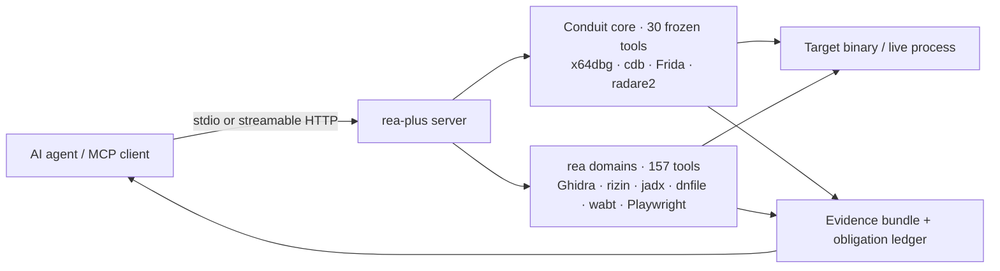

<div align="center">


# Reverse Engine Anything Plus

**Un servidor MCP para ingeniería inversa — depuración en vivo de Windows más un conjunto de 157 herramientas de análisis estático para PE/ELF, Mach-O, .NET, APK, IL2CPP, WASM/EVM, firmware y la web.**

Tu agente hace las preguntas; rea-plus inspecciona el binario y responde con evidencia, no con conjeturas.

[](https://github.com/Alyhnte/ReaPlus/actions/workflows/ci.yml)
[](https://github.com/Alyhnte/ReaPlus/releases)
[](#-features)
[](#-tests)
[](https://nodejs.org)
[](LICENSE)

[Install](#-install) · [Clients](#-client-setup) · [Docker](#-docker) · [Features](#-features) · [Tools](docs/TOOLS.md) · [How it works](#-how-it-works) · [Security](#-security-model) · [Roadmap](docs/ROADMAP.md) · [FAQ](#-faq)

</div>

---

## ✨ ¿Por qué rea-plus?

- 🐞 **Depuración real, no capturas** — motores x64dbg, cdb (WinDbg) y Frida tras un núcleo congelado de 30 herramientas: puntos de interrupción, paso a paso, registros, memoria, pilas de llamadas, puntos de control con viaje en el tiempo.
- 🧩 **157 herramientas estáticas** — Ghidra headless, rizin/radare2, CIL .NET (dnfile) e ILSpy, jadx/apktool/adb, WASM + EVM, firmware, navegador/HAR, UPX, lectores PE/ELF/Mach-O y más.
- 🤝 **Honesto por diseño** — un backend faltante responde `capability_unsupported` con pista de instalación. Nada finge un resultado, los errores vuelven como `isError` MCP propio, y las llamadas mutantes de depuración en vivo exigen `confirm:true`.
- 🧩 **191 herramientas, 2 recursos, 7 prompts** — el catálogo completo generado vive en [`docs/TOOLS.md`](docs/TOOLS.md); `REA_TOOLSETS` deja que los clientes pequeños carguen solo un perfil (ver [Configuración](#-configuration)). Sin token HTTP, solo se registra una allowlist de solo lectura de 44 herramientas en lugar de la superficie completa.
- 🔌 **Dos transportes** — stdio para agentes locales, HTTP streamable (`/mcp` + `/health`, token bearer, validación Host/Origin de localhost) para setups compartidos.
- 🧪 **Probado, no prometido** — un carril de pruebas por defecto de 91 archivos, Ubuntu CI para la línea publicada y pruebas de protocolo que manejan el servidor compilado real.

```console
$ rea-plus-cli doctor            # what is installed on this machine, what is missing
$ rea-plus-cli analyze-evm "transfer(address,uint256)"
transfer(address,uint256) -> 0xa9059cbb
```

```jsonc
// One MCP call your agent makes:
{ "name": "rea_investigate", "arguments": { "path": "sample.exe" } }
// -> sniff + confidence + provider plan + evidence bundle, in one answer
```

## 🚀 Instalación

> **Requisitos:** Node.js ≥ 20. Todo lo demás (Ghidra, rizin, jadx, herramientas Frida, …) es opcional — las herramientas se iluminan a medida que aparecen los backends; ejecuta `doctor` para ver el mapa de tu máquina. Windows es obligatorio para los depuradores en vivo (x64dbg/cdb/Frida attach); el análisis estático corre en todas partes.

### Un clic (Cursor / VS Code)

[](https://cursor.com/install-mcp?name=rea-plus&config=eyJjb21tYW5kIjoibnB4IiwiYXJncyI6WyIteSIsInJlYS1wbHVzIl19)
[](https://vscode.dev/redirect/mcp/install?name=rea-plus&config=%7B%22type%22%3A%22stdio%22%2C%22command%22%3A%22npx%22%2C%22args%22%3A%5B%22-y%22%2C%22rea-plus%22%5D%7D)

### Asistente de configuración (descarga independiente)

¿Sin npm? Descarga [`setup.mjs`](https://github.com/Alyhnte/ReaPlus/releases/latest/download/setup.mjs) (+ [`setup.ps1`](https://github.com/Alyhnte/ReaPlus/releases/latest/download/setup.ps1) en Windows) desde el [último release](https://github.com/Alyhnte/ReaPlus/releases/latest) — solo necesita Node.js 20+:

```bash
node setup.mjs --list        # detect installed clients
node setup.mjs --dry-run     # preview without writing
node setup.mjs --yes         # write MCP config (asks unless --yes)
```

```powershell
.\setup.ps1 --list
.\setup.ps1 --yes
```

O dentro del paquete: `npx -y rea-plus rea-plus-cli setup` (el mismo asistente).

### npx (sin clonar)

Cualquier cliente MCP stdio puede lanzarlo directo desde el registro npm:

```json
{
  "mcpServers": {
    "rea-plus": {
      "command": "npx",
      "args": ["-y", "rea-plus"]
    }
  }
}
```

> **Estado de publicación:** `rea-plus@0.12.0` está en vivo en el [registro npm](https://www.npmjs.com/package/rea-plus) y [`io.github.Alyhnte/rea-plus`](https://registry.modelcontextprotocol.io) está publicado en el MCP Registry. Las instalaciones soportadas son `npx -y rea-plus` (arriba) y GHCR (ver [Docker](#-docker)).

### Clonar y compilar

```bash
git clone https://github.com/Alyhnte/ReaPlus.git
cd ReaPlus
npm ci
npm run build        # tsc + runtime assets (frida-agent.js, Ghidra scripts) -> dist/
npm start            # stdio server (dist/server.js)

# Optional HTTP transport:
node dist/server.js --transport http --port 3848
# -> GET  http://127.0.0.1:3848/health
# -> POST http://127.0.0.1:3848/mcp
```

### Extras opcionales

```bash
# Browser tools (Playwright is an optional dependency, loaded lazily):
npm i playwright && npx playwright install chromium
```

Luego apunta tu agente hacia él y pídele que inspeccione algo.

## 🔌 Configuración de clientes

Cada cliente de abajo recibe el mismo servidor. Archivos listos viven en [`configs/`](configs/).

<details>
<summary><strong>Claude Desktop</strong></summary>

Añade a `claude_desktop_config.json` (ver [`configs/claude-desktop/claude_desktop_config.stdio.json`](configs/claude-desktop/claude_desktop_config.stdio.json)):

```json
{
  "mcpServers": {
    "rea-plus": { "command": "npx", "args": ["-y", "rea-plus"] }
  }
}
```

</details>

<details>
<summary><strong>Claude Code</strong></summary>

```bash
claude mcp add rea-plus -- npx -y rea-plus
```

O suelta [`configs/claude-code/.mcp.json`](configs/claude-code/.mcp.json) en la raíz de tu proyecto.

</details>

<details>
<summary><strong>Cursor</strong></summary>

Haz clic en **Add to Cursor** arriba, o usa [`configs/cursor/mcp.stdio.json`](configs/cursor/mcp.stdio.json) (forma con ruta clonada) / [`mcp.http.json`](configs/cursor/mcp.http.json) (forma HTTP).

</details>

<details>
<summary><strong>VS Code</strong></summary>

Haz clic en **Install in VS Code** arriba, o copia [`configs/vscode/mcp.json`](configs/vscode/mcp.json) a `.vscode/mcp.json` en tu workspace.

</details>

<details>
<summary><strong>Windsurf</strong></summary>

Usa [`configs/windsurf/mcp_config.json`](configs/windsurf/mcp_config.json) como tu `mcp_config.json`.

</details>

<details>
<summary><strong>Codex</strong></summary>

Añade [`configs/codex/config.toml`](configs/codex/config.toml) a `~/.codex/config.toml`:

```toml
[mcp_servers.rea-plus]
command = "npx"
args = ["-y", "rea-plus"]
```

</details>

<details>
<summary><strong>opencode / generic HTTP</strong></summary>

```bash
DBG_BRIDGE_TOKEN=your-secret node dist/server.js --transport http --port 3848
# clients connect to http://127.0.0.1:3848/mcp with Authorization: Bearer <token>
```

Ver [`configs/opencode/`](configs/opencode/opencode.stdio.json) para variantes stdio y HTTP.

</details>

## 🐳 Docker

```bash
# Build locally (works today):
docker build -t rea-plus .

# stdio (for MCP clients that spawn containers):
docker run -i --rm rea-plus

# HTTP:
docker run -p 3848:3848 -e DBG_BRIDGE_TOKEN=your-secret rea-plus --transport http --port 3848 --host 0.0.0.0
```

Imágenes publicadas en GHCR con cada release (`ghcr.io/alyhnte/reaplus`). Los depuradores solo-Windows
(x64dbg/cdb) informan `capability_unsupported` dentro de un contenedor Linux; el análisis
estático, el CLI y ambos transportes funcionan.

## 🧰 Características

La referencia completa generada — **191 herramientas + 2 recursos (`rea-plus://server-info`, `rea-plus://capabilities-safety`) + 7 prompts (`packer-triage`, `dotnet-malware-triage`, `android-triage`, `pe-crash-triage`, `elf-linux-triage`, `binary-diff`, `evidence-report`)** — está en [`docs/TOOLS.md`](docs/TOOLS.md). La tabla de abajo es solo un resumen por dominio.

| Dominio | Qué obtienes | Motor / backend |
|---|---|---|
| Depuración en vivo | Puntos de interrupción, paso/continuar, registros, memoria, pilas de llamadas, puntos de control y rebobinado | x64dbg · cdb · Frida · radare2 (núcleo conduit, 30 herramientas congeladas) |
| Estático nativo (PE/ELF) | Desensamblado, CFG, xrefs, strings, imports, PDB/DWARF, decompilación | Ghidra headless · rizin/Cutter |
| .NET | Detección CLR real, volcado CIL con dnfile, decompilación ILSpy | dnfile · ilspycmd |
| Android | Decodificación/construcción APK, info de framework, puente adb | jadx · apktool · aapt2 · adb |
| Instrumentación dinámica | Attach/spawn, traza de API, puntos de interrupción condicionales, pausa de proceso | Frida 17 |
| Comportamiento | Ejecuciones de proceso con registros SHA-256, captura de red (HAR), líneas de tiempo de eventos | mitmproxy · captura de procesos |
| Web / navegadores | Navegación, clics, capturas, almacenamiento y captura de consola | Playwright (extra opcional) |
| WASM / EVM | Validación (wabt), desensamblado, selectores de función, trabajo de opcodes | wabt · keccak offline |
| Firmware y exóticos | Triage de firmware, pre-escaneos DOS/MIPS/AOT/Go, caza de packers (receta UPX→.NET→volcado) | Inspección estática · UPX |
| Mach-O / Apple | Encabezado + comandos load, salida otool, lectura de bundle/plist (errores honestos sin backends) | Lector integrado · otool |
| Unity IL2CPP | Volcado Il2CppDumper + conteos clase/método de global-metadata (error honesto si falta) | Il2CppDumper · lector de metadatos |
| Diff binario | Listas de funciones (nombre/dirección + hash) y diff entre versiones | Integrado |
| PCAP / TLS | Reensamblaje de flujos + descifrado TLS con keylog | tshark · keylog |
| Dinámica Android | Generación de receta de análisis dinámico + validación en seco de la receta | Receta integrada |
| Escala | Escaneo paralelo de repo (pool de 4, cancelable) | Integrado |
| Investigación | Triage en una llamada: sniff → confianza → plan de proveedores → paquete de evidencias | Orquestador `rea_investigate` |
| Asistencia | Sondeo de capacidades + cachés, cadenas de fallback, sugerencias de config, telemetría | Integrado, offline |
| Incorporación | `setup` asistente escribe configs de cliente (con puerta de confirmación); `doctor --fix` propone comandos de instalación, solo los ejecuta con `--yes` | rea-plus-cli |

## ⚙️ Cómo funciona



- **Núcleo congelado.** Los 30 nombres de herramienta conduit son inmutables (`src/facade/toolNamespace.ts`); los renombres están prohibidos, así los clientes conduit existentes siguen funcionando.
- **Dominios rea.** 157 herramientas `rea_*` se registran centralmente en `src/server/registerReaTools.ts`.
- **Puertas de confirmación.** Las operaciones en vivo que mutan un objetivo exigen `confirm:true`; si no, recibes `confirmation_required`, nunca un efecto secundario silencioso.
- **Un catálogo.** `mergedCatalog()` (8 entradas conduit + 16 rea de requisitos) es la única fuente que `doctor` lee para versiones y enlaces de descarga.
- **Recursos + prompts.** Dos recursos estáticos de solo lectura (`rea-plus://server-info`, `rea-plus://capabilities-safety`) y tres prompts sin efectos secundarios (`packer-triage`, `dotnet-malware-triage`, `android-triage`) se registran junto a las herramientas; los prompts solo devuelven texto y nunca ejecutan una herramienta.
- **Salidas tipadas (parcial).** `structuredContent` refleja el JSON de texto, y la cobertura es deliberadamente parcial: 187 herramientas declaran un `outputSchema` y 187 llevan annotations. Herramientas fuera del conjunto de esquema devuelven JSON de texto sin esquema declarado — ver estado por herramienta en [`docs/TOOLS.md`](docs/TOOLS.md).
- **Perfiles toolset.** `REA_TOOLSETS` filtra el registro a un perfil (unión con comas; nombres desconocidos fallan el arranque en lugar de caer en silencio a `all`). Resources y prompts no se filtran. Herramientas nuevas caen solo en `all` (fail-closed).
- **Raíces (legacy + modern).** Con `REA_ROOTS=1` en la ruta stdio legacy, las raíces del cliente solo pueden estrechar `REA_WORKSPACE_ROOT`; nunca ensancharlo. Roots de protocolo moderno usa el flujo multi-round-trip del SDK (`inputRequired` + `inputResponses`); `notifications/roots/list_changed` solo existe pre-2026, así el refresco ocurre en el siguiente round-trip MRTR.
- **Progreso (generalizado).** Ayudantes de etapa (`createStageProgress`/`onAbort`) acompasan notificaciones (~20/s) y limpian al cancelar; piloto `rea_process_run` sin cambios, `rea_scan_repo` + `rea_jadx_full` con etapas. Los demás handlers síncronos quedan fuera de alcance.
- **Jobs asíncronos (opt-in).** Con `REA_ASYNC_JOBS=1`, cinco herramientas job (`rea_job_start/status/result/cancel/list`) ejecutan herramientas de la whitelist (`rea_process_run`, `rea_scan_repo`, `rea_behavior_run`) en una cola acotada en memoria (2 concurrentes). La superficie por defecto sigue en 191 herramientas; la superficie opt-in es 196.

## 💻 CLI

Los mismos motores se scriptan desde la terminal (`rea-plus-cli`, o `node dist/cli/index.js` en un clon):

```bash
rea-plus-cli analyze-evm "transfer(address,uint256)"     # -> 0xa9059cbb (fully offline)
rea-plus-cli analyze-evm "approve(address,uint256)" --json
rea-plus-cli analyze-wasm sample.wat --json
rea-plus-cli analyze-js bundle.js bundle.js.map
rea-plus-cli doctor --json                               # per-tool readiness report
rea-plus-cli doctor --fix                                # propose install commands for missing tools (--yes applies them)
rea-plus-cli setup --dry-run                             # preview client config changes before writing
```

## 🔧 Configuración

Toda la configuración son variables de entorno — sin archivos de config que editar en el propio servidor.

| Variable | Propósito |
|---|---|
| `DBG_BRIDGE_TOKEN` | Token bearer para el transporte HTTP (sin definir en HTTP = auth off + advertencia de arranque + solo 44 herramientas allowlist de solo lectura registradas, intersectadas con `REA_TOOLSETS`; stdio no se afecta) |
| `DBG_BRIDGE_FRIDA_TIMEOUT_MS` | Timeout RPC del agente Frida (por defecto 30000) |
| `REA_GHIDRA_DIR` | Directorio de instalación Ghidra para análisis con proveedores |
| `REA_UPX_BIN` · `REA_WABT_BIN` · `REA_AAPT2_BIN` | Rutas explícitas de herramienta cuando no están en PATH |
| `REA_JEB_MCP_URL` · `REA_JEB_ALLOW_REMOTE` | Endpoint JEB; remoto (no loopback) requiere `REA_JEB_ALLOW_REMOTE=1` |
| `REA_CDP_URL` | Ata las herramientas de navegador a un endpoint Chrome DevTools existente |
| `REA_CORELIB_DLL` | DLL de runtime .NET preferida para inspección CIL |
| `REA_WORKSPACE_ROOT` | Raíz/raíces de workspace, separadas por delimitador de ruta. Cuando se define, argumentos de ruta `rea_*`, rutas conduit `open_target`/`debug_open` y escrituras derivadas visibles al usuario (`.unpacked`, `.extracted`, salida HAR) deben resolverse dentro de la raíz; sin definir = sin restricción. Superficies temp/caché del operador quedan fuera por diseño (dir de artefactos del navegador, dirs tmp de proyecto/entrada Ghidra, archivo tmp de solicitud hopper, caché framework apktool) |
| `REA_ROOTS` | Poner exactamente a `1` para activar el piloto Roots legacy-stdio. Las raíces `file://` del cliente intersectan con `REA_WORKSPACE_ROOT` y solo pueden estrecharlo; Roots de protocolo moderno no lo activa este flag |
| `REA_TOOLSETS` | Perfiles de herramientas a registrar, separados por comas: `all` (por defecto, 191), `minimal` (8), `static` (98), `android` (27), `dotnet` (20), `web` (26), `debug` (50). Perfiles combinados por unión; un nombre desconocido o vacío falla el arranque. Resources/prompts no se afectan |
| `REA_ASYNC_JOBS` | Poner exactamente a `1` para registrar las 5 herramientas job asíncronas (superficie 192 herramientas). Los jobs son solo en memoria, como máximo 2 concurrentes, y la whitelist es `rea_process_run` + `rea_scan_repo` + `rea_behavior_run` |
| `REA_AUDIT_LOG` | Ruta de un registro de auditoría JSONL (ambos transportes). Cada línea lleva solo `ts`, `transport`, `tool`, `durationMs`, `isError` — nunca argumentos, tokens, rutas ni contenido objetivo. Un error de escritura advierte una vez y desactiva la auditoría en lugar de tumbar el servidor |
| `REA_HTTP_RATE_LIMIT_PER_MIN` | Solicitudes HTTP por IP cliente por minuto (por defecto 120); el exceso recibe `429`. Un valor no entero positivo falla el arranque |
| `REA_HTTP_MAX_CONCURRENT` | Solicitudes máximas en vuelo simultáneas (por defecto 16); el exceso recibe `429`. Un valor no entero positivo falla el arranque |

Herramientas externas se descubren solo desde estas variables y PATH — sin rutas específicas de máquina cocidas.

## 🔒 Modelo de seguridad

rea-plus es un depurador: por diseño puede lanzar, adjuntar e instrumentar procesos locales. Trata su acceso como acceso shell.

- **stdio primero.** El transporte por defecto nunca abre un puerto.
- **HTTP blindado.** Token bearer (comparación en tiempo constante), validación Host/Origin de localhost contra DNS-rebinding/CSRF, límites de tasa y concurrencia por IP (`REA_HTTP_RATE_LIMIT_PER_MIN`, `REA_HTTP_MAX_CONCURRENT`) y — al arrancar sin token — una advertencia alta más una superficie reducida de 44 herramientas allowlist de solo lectura sin rutas (intersectada con `REA_TOOLSETS`) en lugar de las 187.
- **Límite de workspace (opt-in).** Con `REA_WORKSPACE_ROOT` definido, argumentos de ruta `rea_*`, rutas conduit `open_target`/`debug_open` y escrituras derivadas visibles al usuario deben quedarse dentro de la raíz (verificado con realpath, así los escapes por junction/symlink fallan). Superficies temp/caché del operador (artefactos del navegador, dirs tmp Ghidra, archivo tmp de solicitud hopper, caché framework apktool) son una excepción documentada y no se fuerzan dentro de la raíz.
- **Auditoría sin contenido.** `REA_AUDIT_LOG` registra una línea JSONL por llamada con solo hora, transporte, nombre de herramienta, duración e `isError` — nunca argumentos, tokens, rutas ni contenido objetivo.
- **Entradas validadas.** Las direcciones que llegan a lenguajes de comandos backend se restringen a forma hex/decimal/símbolo — sin inyección de comandos a r2/rizin con `;`/`!`.
- **Puerta SSRF.** Las llamadas auxiliares de salida (p. ej., el puente JEB) son solo loopback salvo opt-in del operador; hosts link-local/metadata siempre bloqueados.
- **Sin resultados falsos.** Capacidad faltante ⇒ `capability_unsupported` con motivo; errores de handler ⇒ `isError` MCP solo con el mensaje (sin trazas de pila).
- **Sin ejecución del objetivo en rutas estáticas.** Las rutas de inspección leen bytes; nunca ejecutan la muestra. Ejecuta binarios desconocidos en una VM — para eso está el carril en vivo.

## 🧪 Pruebas

97 archivos de prueba. El carril por defecto (`npm test`) corre 91 archivos y excluye los conjuntos de depuración en vivo/inyección, captura de paquetes, navegador, e2e y Ghidra local — esos tocan procesos reales o installs específicos de máquina y pertenecen a una VM o a un job CI dedicado (`npm run test:live`). Cada archivo tiene tope de 90 s con muerte del árbol de procesos, así un backend colgado nunca puede colgar el carril. El CI de la línea publicada corre el carril por defecto en Ubuntu (Node 20 + 22).

```bash
npm test                        # default lane: 91 files (live suites excluded)
npm run test:live               # everything, incl. frida/sniff/browser/e2e/ghidra (VM/CI only)
npm run test:e2e                # spawn -> /health -> tools/list
node --test tests/evm.test.mjs # single-domain runs work too
```

Detalles: [`docs/VERIFY.md`](docs/VERIFY.md) · [`docs/MCP-CONTRACTS.md`](docs/MCP-CONTRACTS.md) · [`CHANGELOG.md`](CHANGELOG.md)

## 🗺️ Hoja de ruta

Al tope de la lista — la tabla completa priorizada vive en [`docs/ROADMAP.md`](docs/ROADMAP.md):

- npm + MCP Registry en vivo (`rea-plus@0.12.0`, `io.github.Alyhnte/rea-plus`) — installs soportadas: `npx -y rea-plus` y GHCR
- Superficie tipada cerrada: 183 herramientas llevan `outputSchema` (4 permanentemente sin esquema) y 187 llevan annotations; whitelist asíncrona de 3 herramientas, ayudantes de progress cubren las herramientas con etapas
- Completando el corpus dorado de binarios (hashes de salida esperada por proveedor) — incluidos el pendiente check Frida en VM en vivo y la prueba de aceptación DEX dorada del APK
- Releases firmados + SBOM, y un perfil VM documentado para trabajo en vivo

## ❓ FAQ

**¿Necesito Ghidra, IDA, Hopper o JEB?**
No. JS/.NET/WASM/EVM estáticos e inspección offline funcionan sin ellos; la profundidad con proveedores usa tus propias instalaciones cuando existen. Las herramientas comerciales nunca las agrupa ni licencia rea-plus.

**¿Por qué una herramienta devuelve `capability_unsupported`?**
Su backend no está instalado en esta máquina. La respuesta nombra la capacidad faltante y dónde obtenerla (el mismo catálogo que lee `doctor`). Instálalo y la herramienta se ilumina — sin cambios de código.

**¿Por qué las operaciones en vivo piden `confirm:true`?**
Mutan un objetivo en ejecución (puntos de interrupción, paso, escrituras de memoria). La puerta evita que los agentes cambien el estado del programa por accidente.

**¿Choca con conduit?**
No. Conduit usa el puerto 3847 por defecto; rea-plus sirve 3848, y los 30 nombres de herramienta conduit están congelados.

**¿npm dice que el paquete no existe?**
Actualiza tu caché — `rea-plus@0.12.0` está en el [registro npm](https://www.npmjs.com/package/rea-plus) y publicado en el MCP Registry. Usa `npx -y rea-plus` en todas partes o la imagen GHCR.

## 🤝 Contribución

Issues y PR son bienvenidos — informes de errores, ideas de funciones, docs. Ejecuta `npm run typecheck` y `npm test` antes de enviar, mantén congelados los nombres de herramienta conduit y haz que las herramientas nuevas fallen con honestidad (`capability_unsupported`, nunca un `ok` falso).

Si rea-plus te ahorró una tarde de arqueología con editor hexadecimal, una ⭐ ayuda a otros reversers a encontrarlo.

## 📄 Licencia

[MIT](LICENSE). El código rea-plus es MIT; herramientas y proveedores terceros conservan sus licencias — debes obtener legalmente y estar autorizado a usar las herramientas comerciales (IDA Pro, Hopper, JEB) bajo sus términos de vendor.

<div align="center">

**Reverse Engine Anything Plus** · construido sobre el núcleo conduit de depuración en vivo · [Releases](https://github.com/Alyhnte/ReaPlus/releases) · [Roadmap](docs/ROADMAP.md) · [Changelog](CHANGELOG.md)

</div>
