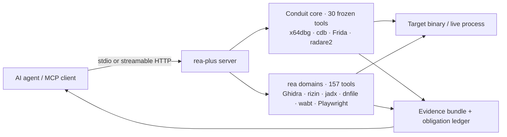

<div align="center">


# Reverse Engine Anything Plus

**Un seul serveur MCP pour le reverse engineering — débogage Windows live plus une suite d'analyse statique de 157 outils pour PE/ELF, Mach-O, .NET, APK, IL2CPP, WASM/EVM, firmware et le web.**

Votre agent pose des questions ; rea-plus inspecte le binaire et répond avec des preuves, pas des suppositions.

[](https://github.com/Alyhnte/ReaPlus/actions/workflows/ci.yml)
[](https://github.com/Alyhnte/ReaPlus/releases)
[](#-features)
[](#-tests)
[](https://nodejs.org)
[](LICENSE)

[Install](#-install) · [Clients](#-client-setup) · [Docker](#-docker) · [Features](#-features) · [Tools](docs/TOOLS.md) · [How it works](#-how-it-works) · [Security](#-security-model) · [Roadmap](docs/ROADMAP.md) · [FAQ](#-faq)

</div>

---

## ✨ Pourquoi rea-plus ?

- 🐞 **Du vrai débogage, pas des captures d'écran** — moteurs x64dbg, cdb (WinDbg) et Frida derrière un cœur figé de 30 outils : breakpoints, pas-à-pas, registres, mémoire, piles d'appels, checkpoints temporels.
- 🧰 **157 outils statiques** — Ghidra headless, rizin/radare2, CIL .NET (dnfile) et ILSpy, jadx/apktool/adb, WASM + EVM, firmware, navigateur/HAR, UPX, lecteurs PE/ELF/Mach-O, et bien plus.
- 🤝 **Honnête par conception** — un backend manquant répond `capability_unsupported` avec un indice d'installation. Rien ne falsifie un résultat, les erreurs reviennent en vraie `isError` MCP, et les appels live-debug qui mutent exigent `confirm:true`.
- 🧩 **191 outils, 2 resources, 7 prompts** — le catalogue complet généré vit dans [`docs/TOOLS.md`](docs/TOOLS.md) ; `REA_TOOLSETS` permet aux petits clients à contexte réduit de ne charger qu'une tranche de profil (voir [Configuration](#-configuration)). Sans token HTTP, seule une allowlist de 44 outils en lecture seule est enregistrée au lieu de la surface complète.
- 🔌 **Deux transports** — stdio pour les agents locaux, HTTP streamable (`/mcp` + `/health`, token bearer, validation Host/Origin localhost) pour les setups partagés.
- 🧪 **Prouvé, pas promis** — un couloir de tests par défaut de 91 fichiers, CI Ubuntu pour la ligne publiée, et des tests de protocole qui pilotent le vrai serveur compilé.

```console
$ rea-plus-cli doctor            # what is installed on this machine, what is missing
$ rea-plus-cli analyze-evm "transfer(address,uint256)"
transfer(address,uint256) -> 0xa9059cbb
```

```jsonc
// One MCP call your agent makes:
{ "name": "rea_investigate", "arguments": { "path": "sample.exe" } }
// -> sniff + confidence + provider plan + evidence bundle, in one answer
```

## 🚀 Installation

> **Prérequis :** Node.js ≥ 20. Tout le reste (Ghidra, rizin, jadx, outillage Frida, …) est optionnel — les outils s'allument à mesure que les backends apparaissent ; lancez `doctor` pour voir la carte de votre machine. Windows est requis pour les débogueurs live (x64dbg/cdb/attachement Frida) ; l'analyse statique tourne partout.

### En un clic (Cursor / VS Code)

[](https://cursor.com/install-mcp?name=rea-plus&config=eyJjb21tYW5kIjoibnB4IiwiYXJncyI6WyIteSIsInJlYS1wbHVzIl19)
[](https://vscode.dev/redirect/mcp/install?name=rea-plus&config=%7B%22type%22%3A%22stdio%22%2C%22command%22%3A%22npx%22%2C%22args%22%3A%5B%22-y%22%2C%22rea-plus%22%5D%7D)

### Assistant de configuration (téléchargement autonome)

Pas de npm ? Téléchargez [`setup.mjs`](https://github.com/Alyhnte/ReaPlus/releases/latest/download/setup.mjs) (+ Windows [`setup.ps1`](https://github.com/Alyhnte/ReaPlus/releases/latest/download/setup.ps1)) depuis la [dernière release](https://github.com/Alyhnte/ReaPlus/releases/latest) — seul Node.js 20+ est nécessaire :

```bash
node setup.mjs --list        # detect installed clients
node setup.mjs --dry-run     # preview without writing
node setup.mjs --yes         # write MCP config (asks unless --yes)
```

```powershell
.\setup.ps1 --list
.\setup.ps1 --yes
```

Ou dans le paquet : `npx -y rea-plus rea-plus-cli setup` (même assistant).

### npx (sans clonage)

Tout client MCP stdio peut le lancer directement depuis le registre npm :

```json
{
  "mcpServers": {
    "rea-plus": {
      "command": "npx",
      "args": ["-y", "rea-plus"]
    }
  }
}
```

> **État de publication :** `rea-plus@0.13.0` est en ligne sur le [registre npm](https://www.npmjs.com/package/rea-plus) et [`io.github.Alyhnte/rea-plus`](https://registry.modelcontextprotocol.io) est publié sur le MCP Registry. Les installations prises en charge sont `npx -y rea-plus` (ci-dessus) et GHCR (voir [Docker](#-docker)).

### Cloner & compiler

```bash
git clone https://github.com/Alyhnte/ReaPlus.git
cd ReaPlus
npm ci
npm run build        # tsc + runtime assets (frida-agent.js, Ghidra scripts) -> dist/
npm start            # stdio server (dist/server.js)

# Optional HTTP transport:
node dist/server.js --transport http --port 3848
# -> GET  http://127.0.0.1:3848/health
# -> POST http://127.0.0.1:3848/mcp
```

### Extras optionnels

```bash
# Browser tools (Playwright is an optional dependency, loaded lazily):
npm i playwright && npx playwright install chromium
```

Puis pointez votre agent dessus et demandez-lui d'inspecter quelque chose.

## 🔌 Configuration des clients

Chaque client ci-dessous reçoit le même serveur. Les fichiers prêts à l'emploi vivent dans [`configs/`](configs/).

<details>
<summary><strong>Claude Desktop</strong></summary>

Ajoutez à `claude_desktop_config.json` (voir [`configs/claude-desktop/`](configs/claude-desktop/claude_desktop_config.stdio.json)) :

```json
{
  "mcpServers": {
    "rea-plus": { "command": "npx", "args": ["-y", "rea-plus"] }
  }
}
```

</details>

<details>
<summary><strong>Claude Code</strong></summary>

```bash
claude mcp add rea-plus -- npx -y rea-plus
```

Ou déposez [`configs/claude-code/.mcp.json`](configs/claude-code/.mcp.json) à la racine de votre projet.

</details>

<details>
<summary><strong>Cursor</strong></summary>

Cliquez sur **Add to Cursor** ci-dessus, ou utilisez [`configs/cursor/mcp.stdio.json`](configs/cursor/mcp.stdio.json) (forme avec chemin cloné) / [`mcp.http.json`](configs/cursor/mcp.http.json) (forme HTTP).

</details>

<details>
<summary><strong>VS Code</strong></summary>

Cliquez sur **Install in VS Code** ci-dessus, ou copiez [`configs/vscode/mcp.json`](configs/vscode/mcp.json) vers `.vscode/mcp.json` dans votre workspace.

</details>

<details>
<summary><strong>Windsurf</strong></summary>

Utilisez [`configs/windsurf/mcp_config.json`](configs/windsurf/mcp_config.json) comme votre `mcp_config.json`.

</details>

<details>
<summary><strong>Codex</strong></summary>

Ajoutez [`configs/codex/config.toml`](configs/codex/config.toml) à `~/.codex/config.toml` :

```toml
[mcp_servers.rea-plus]
command = "npx"
args = ["-y", "rea-plus"]
```

</details>

<details>
<summary><strong>opencode / HTTP générique</strong></summary>

```bash
DBG_BRIDGE_TOKEN=your-secret node dist/server.js --transport http --port 3848
# clients connect to http://127.0.0.1:3848/mcp with Authorization: Bearer <token>
```

Voir [`configs/opencode/`](configs/opencode/opencode.stdio.json) pour les variantes stdio et HTTP.

</details>

## 🐳 Docker

```bash
# Build locally (works today):
docker build -t rea-plus .

# stdio (for MCP clients that spawn containers):
docker run -i --rm rea-plus

# HTTP:
docker run -p 3848:3848 -e DBG_BRIDGE_TOKEN=your-secret rea-plus --transport http --port 3848 --host 0.0.0.0
```

Les images sont publiées vers GHCR à chaque release (`ghcr.io/alyhnte/reaplus`). Les débogueurs
réservés à Windows (x64dbg/cdb) rapportent `capability_unsupported` dans un conteneur Linux ; l'analyse
statique, la CLI et les deux transports fonctionnent.

## 🧰 Fonctionnalités

La référence complète et générée — **191 outils + 2 resources (`rea-plus://server-info`, `rea-plus://capabilities-safety`) + 7 prompts (`packer-triage`, `dotnet-malware-triage`, `android-triage`, `pe-crash-triage`, `elf-linux-triage`, `binary-diff`, `evidence-report`)** — se trouve dans [`docs/TOOLS.md`](docs/TOOLS.md). Le tableau ci-dessous n'est qu'un résumé par domaine.

| Domaine | Ce que vous obtenez | Moteur / backend |
|---|---|---|
| Débogage live | Breakpoints, pas-à-pas/continuation, registres, mémoire, piles d'appels, checkpoints & retour arrière | x64dbg · cdb · Frida · radare2 (cœur conduit, 30 outils figés) |
| Statique natif (PE/ELF) | Désassemblage, CFG, xrefs, chaînes, imports, PDB/DWARF, décompilation | Ghidra headless · rizin/Cutter |
| .NET | Vraie détection CLR, dump CIL via dnfile, décompilation ILSpy | dnfile · ilspycmd |
| Android | Décodage/construction APK, infos framework, pont adb | jadx · apktool · aapt2 · adb |
| Instrumentation dynamique | Attachement/lancement, traçage d'API, breakpoints conditionnels, pause de processus | Frida 17 |
| Comportement | Exécutions de processus avec enregistrements SHA-256, capture réseau (HAR), chronologies d'événements | mitmproxy · capture de processus |
| Web / navigateurs | Navigation, clics, captures d'écran, capture stockage & console | Playwright (extra optionnel) |
| WASM / EVM | Validation (wabt), désassemblage, sélecteurs de fonctions, travail sur opcodes | wabt · keccak hors ligne |
| Firmware & exotique | Triage firmware, pré-analyses DOS/MIPS/AOT/Go, chasse au packer (recette UPX→.NET→dump) | Inspection statique · UPX |
| Mach-O / Apple | En-tête + commandes de chargement, sortie otool, lecture bundle/plist (erreurs honnêtes sans backends) | Lecteur intégré · otool |
| Unity IL2CPP | Dump Il2CppDumper + comptages classes/méthodes des métadonnées globales (erreur honnête si absent) | Il2CppDumper · lecteur de métadonnées |
| Diff binaire | Listes de fonctions (nom/adresse + hash) et diff de version à version | Intégré |
| PCAP / TLS | Réassemblage de flux + déchiffrement TLS par keylog | tshark · keylog |
| Android dynamique | Génération de recette d'analyse dynamique + validation à sec de la recette | Recette intégrée |
| Échelle | Analyse parallèle de dépôt (pool de 4, annulable) | Intégré |
| Investigation | Triage en un seul appel : reniflage → confiance → plan de providers → paquet de preuves | Orchestrateur `rea_investigate` |
| Assistance | Sondage de capacités + mise en cache, chaînes de repli, suggestions de config, télémétrie | Intégré, hors ligne |
| Intégration | L'assistant `setup` écrit les configs clients (sous confirmation) ; `doctor --fix` propose des commandes d'installation, ne les exécute qu'avec `--yes` | rea-plus-cli |

## ⚙️ Comment ça marche



- **Cœur figé.** Les 30 noms d'outils conduit sont immuables (`src/facade/toolNamespace.ts`) ; tout renommage est interdit, les clients conduit existants continuent donc de fonctionner.
- **Domaines rea.** 157 outils `rea_*` enregistrés centralement dans `src/server/registerReaTools.ts`.
- **Portes de confirmation.** Les opérations live qui mutent une cible exigent `confirm:true` ; sinon vous recevez `confirmation_required`, jamais un effet secondaire silencieux.
- **Un seul catalogue.** `mergedCatalog()` (8 entrées conduit + 16 entrées rea de prérequis) est la source unique que `doctor` lit pour les versions et les liens de téléchargement.
- **Resources + prompts.** Deux resources statiques en lecture seule (`rea-plus://server-info`, `rea-plus://capabilities-safety`) et trois prompts sans effets secondaires (`packer-triage`, `dotnet-malware-triage`, `android-triage`) sont enregistrés aux côtés des outils ; les prompts renvoient uniquement du texte et n'exécutent jamais un outil.
- **Sorties typées (partielles).** `structuredContent` reflète le JSON textuel, et la couverture est délibérément partielle : 187 outils déclarent un `outputSchema` et 187 outils portent des annotations. Les outils hors ensemble de schémas renvoient du JSON textuel sans schéma de sortie déclaré — voir [`docs/TOOLS.md`](docs/TOOLS.md) par outil.
- **Profils de toolsets.** `REA_TOOLSETS` filtre l'enregistrement vers une tranche de profil (union avec virgules ; les noms inconnus font échouer le démarrage au lieu de retomber silencieusement sur `all`). Resources et prompts ne sont pas filtrés. Les nouveaux outils atterrissent uniquement dans `all` (fail-closed).
- **Roots (legacy + moderne).** Avec `REA_ROOTS=1` sur le chemin stdio legacy, les racines clientes ne peuvent que restreindre `REA_WORKSPACE_ROOT` ; elles ne peuvent jamais l'élargir. Le Roots du protocole moderne utilise le flux SDK multi-allers-retours (`inputRequired` + `inputResponses`) ; `notifications/roots/list_changed` n'existe qu'avant 2026, le rafraîchissement a donc lieu au prochain tour MRTR.
- **Progression (généralisée).** Les helpers de stages (`createStageProgress`/`onAbort`) rythment les notifications (~20/s) et nettoient sur annulation ; `rea_process_run` pilote inchangé, `rea_scan_repo` + `rea_jadx_full` étagés. Les autres handlers synchrones restent hors périmètre.
- **Jobs async (opt-in).** Avec `REA_ASYNC_JOBS=1`, cinq outils de jobs (`rea_job_start/status/result/cancel/list`) exécutent les outils en whitelist (`rea_process_run`, `rea_scan_repo`, `rea_behavior_run`) via une file bornée en mémoire (2 simultanés). La surface par défaut reste à 191 outils ; la surface opt-in est de 196.

## 💻 CLI

Les mêmes moteurs sont scriptables depuis le terminal (`rea-plus-cli`, ou `node dist/cli/index.js` dans un clone) :

```bash
rea-plus-cli analyze-evm "transfer(address,uint256)"     # -> 0xa9059cbb (fully offline)
rea-plus-cli analyze-evm "approve(address,uint256)" --json
rea-plus-cli analyze-wasm sample.wat --json
rea-plus-cli analyze-js bundle.js bundle.js.map
rea-plus-cli doctor --json                                # per-tool readiness report
rea-plus-cli doctor --fix                                 # propose install commands for missing tools (--yes applies them)
rea-plus-cli setup --dry-run                              # preview client config changes before writing
```

## 🔧 Configuration

Toute la configuration passe par des variables d'environnement — aucun fichier de config à éditer dans le serveur lui-même.

| Variable | Objet |
|---|---|
| `DBG_BRIDGE_TOKEN` | Token bearer pour le transport HTTP (non défini en HTTP = auth désactivée + avertissement au démarrage + seuls 44 outils en lecture seule de l'allowlist enregistrés, en intersection avec `REA_TOOLSETS` ; stdio inchangé) |
| `DBG_BRIDGE_FRIDA_TIMEOUT_MS` | Timeout RPC de l'agent Frida (30000 par défaut) |
| `REA_GHIDRA_DIR` | Répertoire d'installation Ghidra pour l'analyse adossée aux providers |
| `REA_UPX_BIN` · `REA_WABT_BIN` · `REA_AAPT2_BIN` | Chemins d'outils explicites quand absents du PATH |
| `REA_JEB_MCP_URL` · `REA_JEB_ALLOW_REMOTE` | Endpoint JEB ; le distant (non-loopback) exige `REA_JEB_ALLOW_REMOTE=1` |
| `REA_CDP_URL` | Attacher les outils navigateur à un endpoint Chrome DevTools existant |
| `REA_CORELIB_DLL` | DLL de runtime .NET préférée pour l'inspection CIL |
| `REA_WORKSPACE_ROOT` | Racine(s) de workspace, séparées par le délimiteur de chemin. Quand définie, les arguments de chemin `rea_*`, les chemins conduit `open_target`/`debug_open` et les écritures dérivées visibles par l'utilisateur (`.unpacked`, `.extracted`, sortie HAR) doivent se résoudre dans une racine ; non définie = aucune restriction. Les surfaces temp/cache de l'opérateur restent volontairement hors de cette frontière par conception (répertoire d'artefacts navigateur, répertoires tmp Ghidra projet/entrée, fichier tmp de requête hopper, cache framework apktool) |
| `REA_ROOTS` | Mettre exactement à `1` pour activer le pilote Roots stdio-legacy. Les racines `file://` clientes intersectent `REA_WORKSPACE_ROOT` et ne peuvent que la restreindre ; le Roots du protocole moderne n'est pas activé par ce flag |
| `REA_TOOLSETS` | Profils d'outils à enregistrer, séparés par virgules : `all` (défaut, 191), `minimal` (8), `static` (98), `android` (27), `dotnet` (20), `web` (26), `debug` (50). Les profils combinés s'unissent ; un nom inconnu ou vide fait échouer le démarrage. Resources/prompts inchangés |
| `REA_ASYNC_JOBS` | Mettre exactement à `1` pour enregistrer les 5 outils de jobs async (192 outils au total). Les jobs sont uniquement en mémoire, au plus 2 simultanés, et la whitelist est `rea_process_run` + `rea_scan_repo` + `rea_behavior_run` |
| `REA_AUDIT_LOG` | Chemin d'un journal d'audit JSONL (les deux transports). Chaque ligne porte uniquement `ts`, `transport`, `tool`, `durationMs`, `isError` — jamais arguments, tokens, chemins ni contenu cible. Une erreur d'écriture avertit une fois et désactive l'audit au lieu de planter le serveur |
| `REA_HTTP_RATE_LIMIT_PER_MIN` | Requêtes HTTP par IP cliente par minute (120 par défaut) ; l'excès reçoit `429`. Une valeur non entière positive fait échouer le démarrage |
| `REA_HTTP_MAX_CONCURRENT` | Maximum de requêtes HTTP simultanées en vol (16 par défaut) ; l'excès reçoit `429`. Une valeur non entière positive fait échouer le démarrage |

Les outils externes sont découverts uniquement depuis ces variables et le PATH — aucun chemin spécifique à une machine n'est codé en dur.

## 🔒 Modèle de sécurité

rea-plus est un débogueur : par conception, il peut lancer, attacher et instrumenter des processus locaux. Traitez son accès comme un accès shell.

- **stdio d'abord.** Le transport par défaut n'ouvre jamais un port.
- **HTTP est verrouillé.** Token bearer (comparaison en temps constant), validation Host/Origin localhost contre DNS-rebinding/CSRF, limites de débit et de concurrence par IP (`REA_HTTP_RATE_LIMIT_PER_MIN`, `REA_HTTP_MAX_CONCURRENT`), et — au démarrage sans token — un avertissement bruyant plus une surface réduite de 44 outils en lecture seule de l'allowlist, sans chemins (en intersection avec `REA_TOOLSETS`) au lieu des 187.
- **Frontière de workspace (opt-in).** Avec `REA_WORKSPACE_ROOT` défini, les arguments de chemin `rea_*`, les chemins conduit `open_target`/`debug_open` et les écritures dérivées visibles par l'utilisateur doivent rester dans la racine (vérifiés par realpath, les évasions par jonction/symlink échouent donc). Les surfaces temp/cache de l'opérateur (artefacts navigateur, répertoires tmp Ghidra, fichier tmp de requête hopper, cache framework apktool) sont une exception documentée et ne sont pas forcées dans la racine.
- **Audit sans contenu.** `REA_AUDIT_LOG` enregistre une ligne JSONL par appel d'outil avec uniquement heure, transport, nom d'outil, durée et `isError` — jamais arguments, tokens, chemins ni contenu cible.
- **Les entrées sont validées.** Les adresses atteignant les langages de commandes des backends sont restreintes à la forme hex/décimale/symbole — pas d'injection de commandes `;`/`!` vers r2/rizin.
- **Porte SSRF.** Les appels helpers sortants (par ex. le pont JEB) sont loopback-only sauf opt-in de l'opérateur ; les hôtes link-local/métadonnées sont toujours bloqués.
- **Pas de faux résultats.** Capacité manquante ⇒ `capability_unsupported` avec une raison ; erreurs de handlers ⇒ `isError` MCP avec le message seul (aucune trace de pile).
- **Aucune exécution de cible dans les chemins statiques.** Les outils d'inspection lisent des octets ; ils n'exécutent jamais l'échantillon. Exécutez les binaires inconnus dans une VM — c'est à cela que sert le couloir live.

## 🧪 Tests

97 fichiers de tests. Le couloir par défaut (`npm test`) exécute 91 fichiers et exclut les suites live-injection/débogueur, capture de paquets, navigateur, e2e et Ghidra locale — celles-ci touchent de vrais processus ou des installations spécifiques à la machine et appartiennent à une VM ou à un job CI dédié (`npm run test:live`). Chaque fichier est plafonné à 90 s avec destruction de l'arbre de processus, un backend bloqué ne peut donc jamais bloquer le couloir. Le CI de la ligne publiée exécute le couloir par défaut sur Ubuntu (Node 20 + 22).

```bash
npm test                        # default lane: 91 files (live suites excluded)
npm run test:live               # everything, incl. frida/sniff/browser/e2e/ghidra (VM/CI only)
npm run test:e2e                # spawn -> /health -> tools/list
node --test tests/evm.test.mjs # single-domain runs work too
```

Détails : [`docs/VERIFY.md`](docs/VERIFY.md) · [`docs/MCP-CONTRACTS.md`](docs/MCP-CONTRACTS.md) · [`CHANGELOG.md`](CHANGELOG.md)

## 🗺️ Feuille de route

En tête de liste — le tableau complet et priorisé vit dans [`docs/ROADMAP.md`](docs/ROADMAP.md) :

- npm + MCP Registry sont en ligne (`rea-plus@0.13.0`, `io.github.Alyhnte/rea-plus`) — les installations prises en charge sont `npx -y rea-plus` et GHCR
- La surface typée est close : 183 outils portent `outputSchema` (4 durablement sans schéma) et 187 portent des annotations ; la whitelist async est de 3 outils, les helpers de progression couvrent les outils étagés
- Finalisation du corpus binaire golden (hashes de sorties attendues par provider) — dont la vérification Frida live sur VM encore ouverte et le test d'acceptation APK DEX golden
- Releases signées + SBOM, et un profil sandbox VM documenté pour le travail live

## ❓ FAQ

**Faut-il Ghidra, IDA, Hopper ou JEB ?**
Non. Le JS/.NET/WASM/EVM statique et l'inspection hors ligne fonctionnent sans eux ; la profondeur adossée aux providers utilise vos propres installations quand elles sont présentes. Les outils commerciaux ne sont jamais groupés ni licenciés par rea-plus.

**Pourquoi un outil renvoie-t-il `capability_unsupported` ?**
Son backend n'est pas installé sur cette machine. La réponse nomme la capacité manquante et où l'obtenir (le même catalogue que lit `doctor`). Installez-le et l'outil s'allume — sans changements de code.

**Pourquoi les opérations live exigent-elles `confirm:true` ?**
Elles mutent une cible en cours d'exécution (breakpoints, pas-à-pas, écritures mémoire). La porte empêche les agents de changer l'état du programme par accident.

**Cela entre-t-il en conflit avec conduit ?**
Non. Conduit utilise par défaut le port 3847 ; rea-plus sert 3848, et les 30 noms d'outils conduit sont figés.

**npm dit que le paquet est introuvable ?**
Mettez à jour votre cache — `rea-plus@0.13.0` est sur le [registre npm](https://www.npmjs.com/package/rea-plus) et publié sur le MCP Registry. Utilisez `npx -y rea-plus` partout ci-dessus ou l'image GHCR.

## 🤝 Contribution

Issues et PR sont bienvenues — rapports de bugs, idées de fonctionnalités, docs. Exécutez `npm run typecheck` et `npm test` avant de soumettre, gardez les noms d'outils conduit figés, et faites échouer honnêtement les nouveaux outils (`capability_unsupported`, jamais un faux `ok`).

Si rea-plus vous a épargné un après-midi d'archéologie à l'éditeur hexadécimal, un ⭐ aide les autres reverseurs à le trouver.

## 📄 Licence

[MIT](LICENSE). Le code rea-plus est sous licence MIT ; les outils et providers tiers conservent leurs propres licences — vous devez obtenir légalement les outils commerciaux (IDA Pro, Hopper, JEB) et être autorisé à les utiliser selon leurs conditions de fournisseur.

<div align="center">

**Reverse Engine Anything Plus** · construit sur le cœur live-debug conduit · [Releases](https://github.com/Alyhnte/ReaPlus/releases) · [Roadmap](docs/ROADMAP.md) · [Changelog](CHANGELOG.md)

</div>
